# M88gnのデバッガとペイン

M88gnのデバッガ（Debugメニュー）と、デバッグの窓を本体の窓の中に並べるペイン（ドック）の使い方です。

デバッガは、蕎麦P氏のM88am（<https://www.ambientworks.jp/m88am/>）のものを取り込み、M88gnで機能を足したものです。M88amはC++版のZ80で動かしていますが、M88gnはx86版のZ80のまま使えるようにしています。

この説明の図は、`BPTEST.t88`（D000〜D027にマシン語を書き、BASICからCALLでくり返し呼ぶ試験用のプログラム）を動かし、ラベル・ブレークポイント・ウォッチを付けて止めたところです。

* [ペイン（ドック）](#ペインドック)
* [止める・進める](#止める進める)
* [コードの窓](#コードの窓)
* [メモリの窓](#メモリの窓)
* [レジスタの窓](#レジスタの窓)
* [ブレークポイント](#ブレークポイント)
* [ウォッチ](#ウォッチ)
* [ラベル](#ラベル)
* [トレース](#トレース)
* [ステータスの窓とラップタイム](#ステータスの窓とラップタイム)
* [そのほかの窓](#そのほかの窓)
* [窓に共通の操作](#窓に共通の操作)
* [設定の保存](#設定の保存)

## ペイン（ドック）

デバッグの窓は、浮いた窓のまま使うほかに、本体の窓の上下左右のペインに入れて使えます。ペインはタブで窓を切り替え、1つのペインを区画に分けて複数の窓を並べることもできます。

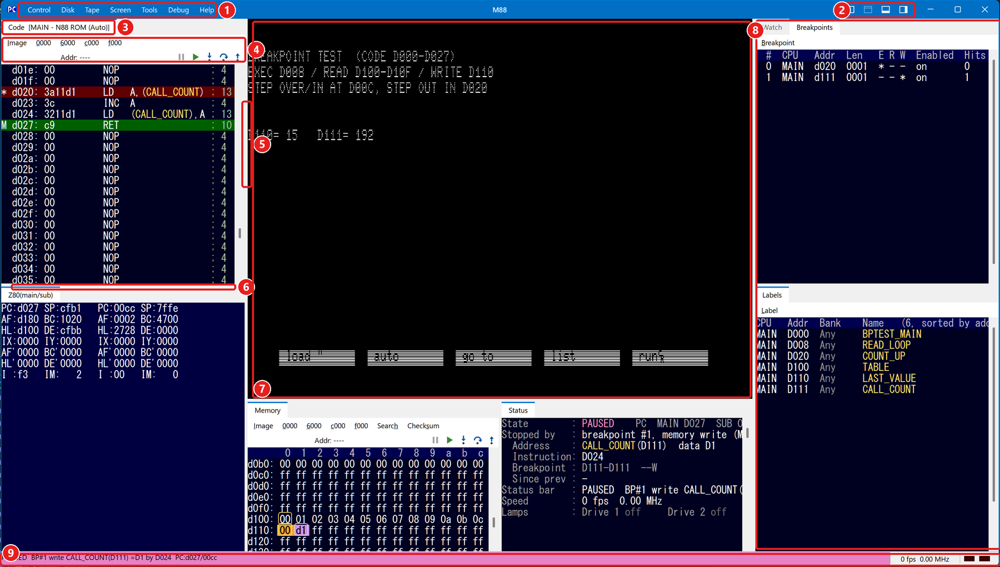

1. **タイトルの段のメニュー**：本体の窓は、Windowsのタイトルバーとメニューバーを1段にまとめています。メニューの名前を押すとメニューが開き、開いたままマウスや←→で隣のメニューへ移れます。
2. **ペインの開閉ボタン**：左から、左・上・下・右のペインを開く・閉じる。開いているペインは塗りつぶして描きます。窓の入っていないペインのボタンは灰色です。Debugメニューの**Dock Panes**でも開閉できます。
3. **タブ**：区画に入っている窓の名前です。押すとその窓に切り替えます。選んでいるタブは上に色の線が付きます。
4. **メニューの帯**：ペインに入れた窓のメニューバーは、タブの下の帯に出ます。Pause・PlayなどのボタンとAddrの欄も、ここに出ます。
5. **ペインの仕切り**：ドラッグしてペインの幅（上下のペインは高さ）を変えます。
6. **区画の仕切り**：同じペインの区画の間の仕切りです。ドラッグして区画の大きさを分け直します。
7. **PC-8801の画面**：ペインを除いた残りの所に、縦横の比を保って描きます（余りは濃い灰色）。周りに枠があり、キー入力がPC-8801に行っている（画面にフォーカスがある）間は青い枠（テーマによらず同じ色）、ペインの窓にフォーカスがある間はペインの仕切りと同じ色になります。ペインの窓をクリックするとその窓に、画面をクリックするとPC-8801にキー入力が移ります（テープの窓はキー入力を取りません）。
8. **区画を分けたペイン**：この図の右のペインは、上の区画にWatchとBreakpointsのタブ、下の区画にLabelsを入れています。
9. **ステータスバー**：止まっている間はピンクになり、止まった理由を出します（[止める・進める](#止める進める)）。fpsと動作周波数も、ここに出します。

ペインに入れられるのは、Debugメニューで開くデバッグの窓（Code・Memory・Register・Breakpoints・Watch・Trace・Labels・Status・Lap Timesなど）、Videoの窓、Tapeメニューのテープの窓です。ソフトウェアキーボードは入れられません。全画面の間は、ペインを隠して画面だけを出します。

### 窓をペインに入れる

浮いた窓のタイトルバーを右クリックして出るメニューで選びます。

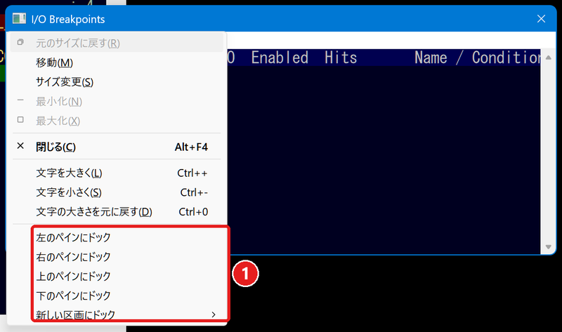

* **左のペインにドック**／**右のペインにドック**／**上のペインにドック**／**下のペインにドック**：そのペインの最後の区画に、タブとして入れます。
* **新しい区画にドック**：そのペインに新しい区画を作って入れます（左右のペインは下に、上下のペインは右に足します）。

一度ペインに入れた窓は、閉じて開き直したときも、同じペインの同じ区画に戻ります。M88を終わるときに開いていた窓は、次に起動したときに同じ並びで開きます。

### タブの右クリックのメニュー

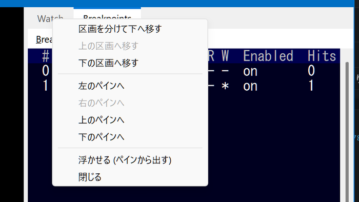

* **区画を分けて下へ移す**（上下のペインでは「右へ」）：その窓だけを、すぐ後ろに作った新しい区画へ移します。区画にタブが2つ以上あるときだけ使えます。
* **上の区画へ移す**／**下の区画へ移す**：隣の区画へ移します。
* **左のペインへ**〜**下のペインへ**：ほかのペインへ移します。
* **浮かせる（ペインから出す）**：浮いた窓に戻します。位置と大きさは、ペインに入れる前のものです。
* **閉じる**：窓を閉じます。

### タブのドラッグ

タブを押したまま動かすと、窓を別の場所へ移せます。落とす先は半透明の四角で示します（図は、左のペインへ移すところ）。

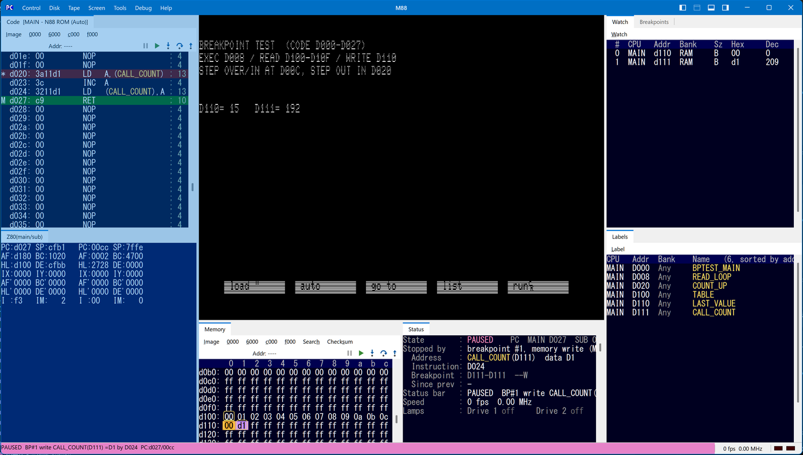

* ほかの区画のタブの上：その区画の、その位置に入れます。
* 区画の上下の端（左右のペインでは上下、上下のペインでは左右の1/4）：区画を分けて、その側に入れます。
* 区画の真ん中：その区画の最後に入れます。
* PC-8801の画面の端（1/5）：そのペインに入れます。閉じているペインなら開きます。
* 本体の窓の外：浮かせて、マウスの所に出します。
* Escかマウスの右ボタンで、ドラッグをやめます。

### ペインを開閉したときの窓の大きさ

ペインを開いても閉じても、本体の窓の大きさは変わりません。PC-8801の画面が、残りの所に合わせて広がったり縮んだりします。本体の窓の枠をドラッグすれば、いつでも大きさを変えられます（最大化もできます）。

Screenメニューの**Window scale**でx1〜x4を選ぶと、画面がちょうどその倍率になるように、開いているペインの分も足した大きさに本体の窓を合わせます。窓の大きさを変えたり、ペインを開閉したり、仕切りを動かしたりして画面が倍率どおりでなくなると、**Free (resize window)**にチェックが移ります。Freeのときの窓の大きさは保存し、次に起動したときも同じ大きさで開きます。

## 止める・進める

Debugメニュー、またはコード・メモリ・Videoの窓のメニューバーの右のボタンで操作します。ボタンにマウスを載せると、名前とキーが出ます。

* **Pause**（Alt+F5。アプリケーションキーの設定ではApp+F5）／**Play**（F5）：止める・動かす。
* **Step In**（F11）：1命令だけ進める。
* **Step Over**（F10）：CALL・RST・LDIRなどは、終わるまでまとめて進める。
* **Step Out**（Shift+F11）：呼び出し元に戻るまで進める（スタックの先頭が戻り番地に見えるときだけ）。
* **Skip Interrupts while Stepping**：Step Inの途中で割り込みが入っても、割り込みの処理の中では止めず、戻ってきてから止める。
* F5/F10/F11は、止まっている間だけデバッガに使います。動いている間は、今までどおりPC-8801のキーとして渡します。

止まっている間は、ステータスバーがピンクになり、次のように出します。

```
PAUSED  BP#1 write CALL_COUNT(D111) =D1 by D024  PC:d027/00cc
```

* 止まった理由：ブレークポイント（`BP#番号`、I/Oなら`IO BP#番号`。番号はブレークポイントの窓の一覧の番号）、読み・書き・IN・OUT・パターン・実行、`Step`、`Pause`。
* 読み書きした値（`=D1`）と、その命令の番地（`by D024`）。番地にラベルがあれば名前も出します。
* メインCPUとサブCPUのPC。
* 2回目からは、前に止まってからのメインCPUのクロック数と時間（ストップウォッチ。`+27 clk`のように出します）。メモリのウェイトを含みます。

## コードの窓

Debug→**Show Code**。逆アセンブルした命令を出します。

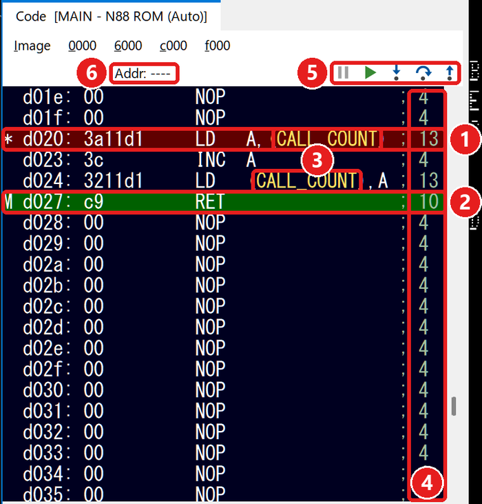

1. **ブレークポイント**：実行のブレークポイントのある行は赤く、行の頭に`*`が付きます。行をクリックすると、実行のブレークポイントを付け外しします。
2. **今のPC**：止まっているときのPCの行は緑で、行の頭に`M`（メインCPU）か`S`（サブCPU）が付きます。止まるとPCの所へ移ります（PC Follow）。
3. **ラベル**：飛び先（JP・CALL・JR・DJNZ）や、命令に書かれた番地（`LD A,(nnnn)`の括弧の中など）にラベルがあれば、名前で出します（黄色）。行の番地にラベルがあれば、行の右の端に名前を出します。
4. **サイクル数**：命令のサイクル数（Z80のTステート）。条件で変わる命令は「成立したとき/しないとき」です（Image→**Show Cycles**で出す・隠す）。PC-8801のメモリのウェイトは含みません。
5. **Pause・Play・Step In・Step Over・Step Outのボタン**：窓が狭くて1段に収まらないときは、2段目に並べます。
6. **Addrの欄**：マウスの下の行の番地とラベル。マウスの下の行には下線を引きます。

そのほかの操作：

* **Ctrl+G**：番地へ飛ぶ（番地は16進かラベルの名前）。
* メニューの**0000**・**6000**・**c000**・**f000**：その範囲に見せるバンク（RAM・ROM・ERAM・拡張ROMなど）。**Auto (follow CPU)**（既定）なら、メインCPUがいま見ているものを出し、窓の題に「(Auto)」と出します。
* Image→**Save...**／**Save with Labels...**／**Save as Source (for Assembler)...**：範囲を指定して、逆アセンブルをファイルに保存します。ラベル付きの保存は、ラベルの行と名前で書いた飛び先を入れます。アセンブラ用の保存は、`ORG`・`EQU`・ラベルの行を入れ、公式でない命令は`DB`で書きます。

### コードの窓の右クリックのメニュー

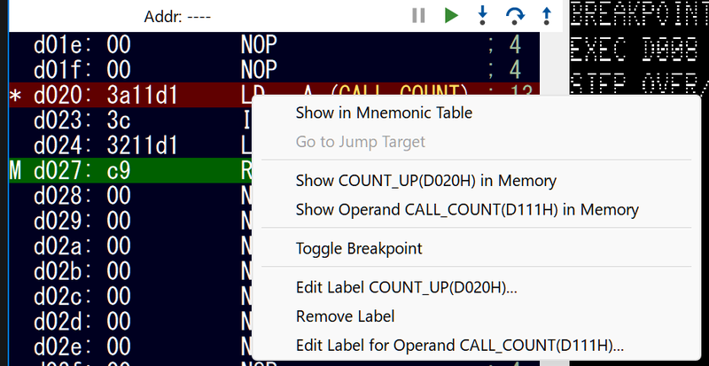

* **Show in Mnemonic Table**：ニーモニック表のその命令の行へ。
* **Go to Jump Target**：飛び先へ（飛ばない命令では灰色）。
* **Show ... in Memory**／**Show Operand ... in Memory**：メモリの窓で、その行の番地・命令に書かれた番地を出す。
* **Toggle Breakpoint**：実行のブレークポイントを付け外し。
* **Set Label**／**Edit Label**／**Remove Label**、**Set Label for Target**／**for Operand**：その行・飛び先・命令に書かれた番地にラベルを付ける・直す・外す。

メニューの番地は、ラベルがあれば「名前(番地)」で出します。

## メモリの窓

Debug→**Show Memory**。メモリの中身を16進と文字で出します。

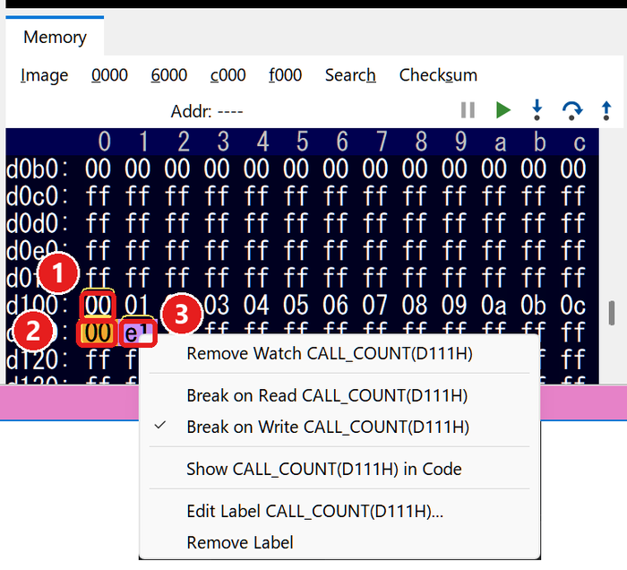

1. **ラベルの付いた番地**：値を黄色の角丸の箱で囲みます。マウスを載せると、ラベルの名前を出します。
2. **ウォッチの番地**：橙で出します（この図は、ウォッチとラベルの両方）。
3. **ブレークポイントの番地**：読み・書きのブレークポイントは赤、ウォッチと両方なら紫で出します。無効なブレークポイントは灰色です。

データ（16進の欄か文字の欄）の上の右クリックで、図のメニューを出します。

* **Add Watch**／**Remove Watch**：ウォッチを足す・外す。
* **Break on Read**／**Break on Write**：読み・書きのブレークポイントを付ける・外す。
* **Show ... in Code**：コードの窓でその番地を出す。
* **Set Label**／**Edit Label**／**Remove Label**：ラベルを付ける・直す・外す。

そのほかの操作：

* **Ctrl+G**：番地へ飛ぶ。
* **Search**：文字列やバイト列を探します（下の[検索](#検索)）。
* **Checksum**：1行16バイトの横にチェックサムを出します（None／工学社（I/O・PiO）：16バイトの和の下位1バイト／アスキー（ASCII・LOGiN）：番地の上位・下位と16バイトの和の下位1バイト／電波新聞社（マイコンBASICマガジン）：1バイトごとに足して桁上がりを捨て、左に1ビット回す）。Ctrl+Cのコピーにも付きます。
* Image→**Save Range...**／**Load Range...**：今表示しているバンクの、指定した範囲をファイルに保存・ファイルから読み込みます。
* **c000**のメニューで、c000〜をGVRAMの面（B/R/G）で見られます。
* メニューバーの**Addr**の欄に、マウスの下の番地とラベルを出します。マウスの下の行に下線を、桁に縦線を引きます。

### 検索

メモリの窓の**Search**→**Find...**（Ctrl+F）で検索の窓を出し、文字列か16バイトまでのバイト列を探します。

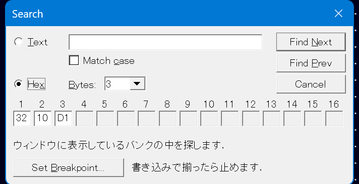

* **Text**：文字列を探します（64字まで）。**Match case**で大文字・小文字を区別します。半角カナは、そのままPC-8801の文字コードとして探します。
* **Hex**：バイト列を探します。**Bytes**で長さ（1〜16）を選び、1〜16の欄に16進の2桁で入れます（2桁入れると次の欄へ移ります。長さを超えた欄は灰色です）。
* 欄をクリックすると、その方式（TextかHex）が選ばれます。
* **Find Next**／**Find Prev**：後ろ・前へ探します。検索の窓を閉じた後は、**Find Next**（F3）／**Find Previous**（Shift+F3）で続けて探せます。
* **Set Breakpoint...**：今のパターンで、パターンのブレークポイント（[ブレークポイント](#パターンのブレークポイント)）を作ります。

探すのは、今メモリの窓に表示しているバンク（0000・6000・c000・f000のメニューで選んでいるもの）です。前に見つけた所（窓に見えていなければ、窓の先頭）の次から探し、端まで行ったら反対の端から探し直します。FFFFと0000をまたぐ並びは探しません。

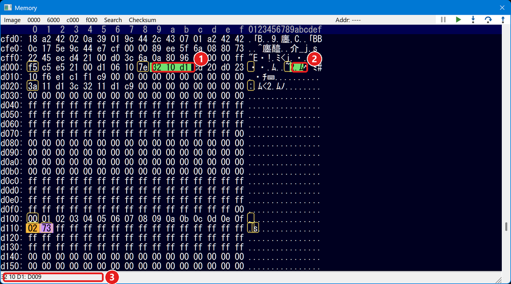

1. 見つけたバイト列は、16進の欄を緑で出し、その行が窓の中に見えるように動かします。
2. 文字の欄も緑で出します。
3. 窓の下に、探したものと見つけた番地を出します（端から探し直したときは「(wrapped to top)」、無ければ「not found」）。

## レジスタの窓

Debug→**Show Register**。メインCPUとサブCPUのレジスタを出します。

* 止まっている間、ダブルクリックで値を書き換えられます。
* 16ビットのレジスタ（AF以外）の上の右クリックで、そのレジスタの値の番地をメモリの窓・コードの窓で出します。

## ブレークポイント

Debug→**Show Breakpoints**で、実行・メモリの読み書き・パターンのブレークポイントの窓を出します。I/Oポートのブレークポイントは、Debug→**Show I/O Breakpoints**の別の窓です。

### ブレークポイントの窓

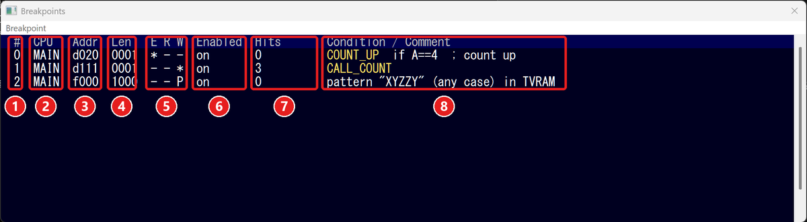

1. **#**：ブレークポイントの番号。止まったときのステータスバーの「BP#番号」と同じです。
2. **CPU**：MAIN（メインCPU）かSUB（ディスク側のCPU）。
3. **Addr**：番地（範囲なら先頭）。パターンのブレークポイントは、探す範囲の先頭です。
4. **Len**：範囲の長さ（16進）。
5. **E R W**：実行（E）・読み（R）・書き（W）のどれで止めるか（`*`が止める）。パターンのブレークポイントは、Wの列に`P`と出します。
6. **Enabled**：有効（on）か無効（off）。無効の行は灰色で出します。
7. **Hits**：条件が成り立った回数（条件が無ければ、止めた回数）。**Hit count**を決めていれば「回数/止める回数」です。設定を変えると0に戻ります。
8. **Condition / Comment**：番地のラベル（黄色）、条件（`if`の後）、コメント（`;`の後）。パターンのブレークポイントは、パターンとバンクを出します。

操作：

* 行をクリックで選び、ダブルクリックで編集します。E・R・W・Enabledの欄をダブルクリックすると、その欄だけを切り替えます。
* Insertキーで追加、Deleteキーで選んだ行を消します。
* 行の右クリックのメニュー：**Show 番地 in Code**／**Show 番地 in Memory**（その番地をコードの窓・メモリの窓で出す。パターンはそのバンクで、範囲に印を付けます。I/Oポートでは出ません）・**Edit...**・**Delete**・**Enable**・**Disable**（今の状態の方は灰色）。

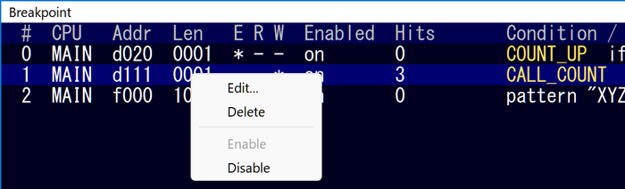

* メニューバーの**Breakpoint**：**Add...**（追加）、**Add Pattern...**（パターンのブレークポイントの追加）、**Edit...**、**Delete**、**Delete All**、**Enable All**（すべて有効に）、**Disable All**（すべて無効に）。
* メモリの窓の右クリックの**Break on Read**／**Break on Write**や、コードの窓の行のクリックでも足せます。

### ブレークポイントの設定

**Add...**・**Edit...**で出す窓です。

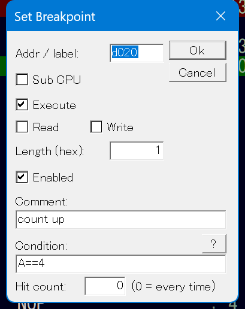

* **Addr / label**：番地（16進）かラベルの名前。
* **Sub CPU**：ディスク側のCPUのブレークポイント。
* **Execute**／**Read**／**Write**：実行・メモリの読み・メモリの書きで止めます。読み書きのブレークポイントは、読み書きした命令の次の命令の前で止まります。
* **Length (hex)**：範囲の長さ。範囲の中のどこかを実行・読み書きしたら止めます。
* **Enabled**：有効にするか。
* **Comment**：一覧に出すメモ。
* **Condition**：条件の式。成り立ったときだけ止めます。書き方の説明は「?」ボタンで出ます。書き方を間違えると、何文字目が違うかを知らせ、窓を閉じません。
  * レジスタ（A〜L・F・I・R・AF〜SP・PC・IXH・IXLなど、裏レジスタも）、フラグ（ZF・CF・SF・PF/VF・HF・NF）
  * 読み書きした値（DATA）と番地（ADDR）。実行とINのブレークポイントではDATAは使えません。
  * メモリ（`[番地]`で1バイト、`W[番地]`で2バイト。CPUが今見ているメモリ）
  * ラベルの名前（その番地）
  * Cと同じ演算子（`==` `!=` `<` `&&` `||` `&` `|` `+` `-` など）と優先順位
  * 数は16進（先頭は数字。`$` `0x` `H`も使える）、10進は`#`を付ける
  * 例：`A==3 && [C000]!=0`、`PC==COUNT_UP`、`W[HL]>#1000`
* **Hit count**：条件が成り立ったその回数目から止めます（0と1は毎回）。

### パターンのブレークポイント

ブレークポイントの窓のBreakpoint→**Add Pattern...**か、メモリの窓の検索の**Set Breakpoint...**で出す窓です。

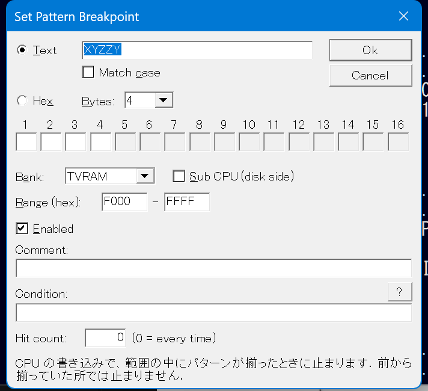

指定した文字列・バイト列が、CPUの書き込みで、範囲の中にそろった瞬間に止まります。前からそろっていた所では止まりません。DMAやディスクなど、CPU以外の書き込みは見ません。プログラムがメッセージを書き出した瞬間や、データを展開し終えた瞬間を捕まえるのに使います。

* **Text**／**Hex**：パターン（検索の窓と同じ）。
* **Bank**：見るメモリ（RAM・ERAM・GVRAM・TVRAMなど）。**Sub CPU**ならディスク側のCPUのメモリ（4000〜7FFF）。
* **Range (hex)**：探す範囲。バンクやCPUを変えると、そのバンクのいっぱいの範囲になります。範囲の外なら、置ける範囲を知らせます。
* **Enabled**・**Comment**・**Condition**・**Hit count**：ほかのブレークポイントと同じ。

止まると、ステータスバーに「Pattern 番地」と出し、メモリの窓でそろった所を緑で出します。

### I/Oポートのブレークポイント

Debug→**Show I/O Breakpoints**。IN・OUTで止めます。一覧はPort・Cnt・I（IN）・O（OUT）・Enabled・Hits・Name / Condition / Comment（ポートの用途）の列で、操作はブレークポイントの窓と同じです。

* 追加・編集の窓の**Select...**で、ポートを分類ごとのメニューから説明付きで選べます（ディスク側のCPUのポートなら、Sub CPUにチェックが付きます）。
* そのCPUで何もつながっていないポートは知らせます（もう一方のCPUにあれば、それも出します）。
* **Condition**・**Hit count**も使えます（INのときはDATAは使えません）。

## ウォッチ

Debug→**Show Watch**。指定した番地の値（1バイトか2バイト）を、16進・10進・2進・文字で出します。

* 値をダブルクリックすると書き換えられます。
* ウォッチごとに**バンク**（RAM・N88/N ROM・ERAM・拡張ROM E0〜E3・GVRAM・TVRAM・N80のROM）を選べます。番地で選べるバンクを絞り、範囲の外なら知らせます。
* メモリの窓の右クリックでも足せます。
* 行の右クリックのメニュー：**Show 番地 in Code**／**Show 番地 in Memory**（ウォッチのバンクで出す）・**Edit...**・**Edit Value...**・**Delete**。

## ラベル

番地に名前を付けます。名前はコード・メモリの窓、ブレークポイント・ウォッチ・トレース・ステータス・ラップタイムの窓、各窓の右クリックのメニュー、ステータスバーで使い、デバッグの窓では黄色で出します。番地の入力欄と条件式でも、番地の代わりに名前を使えます。

* 付け方：コード・メモリの窓の右クリック、ラベルの一覧の窓（Debug→**Show Labels**）のLabel→**Add...**（Insert）。
* 名前は31字まで。1字目は英字か`_` `.` `?` `@`、2字目からはそれと数字・`$`。レジスタと条件の名前（A・HL・NZなど）は使えません。CPU・バンクが違っても、同じ名前（大文字・小文字を区別しない）は付けられません。
* バンク：ラベルはCPU（メイン/サブ）とバンクごとに持ちます。**Any**はどのバンクでも出します。そのバンクのラベルがあればそれを、無ければAnyのラベルを使います。
* ラベルの一覧の窓：番地順・名前順に並べ替え、ダブルクリック（Enter）で名前を変え、Deleteで外し、右クリックでコード・メモリの窓へ（ラベルのバンクで出します。Anyなら今のバンクのまま）。
* Debug→**Export Labels...**／**Import Labels...**：ラベルをテキストファイルに書き出す・読み込む。書き出しは「番地 名前」（バンクがあれば「バンク:番地 名前」、サブCPUは「S:番地 名前」）。読み込みは、番地の書き方（`1234`・`1234H`・`$1234`・`0x1234`・`&H1234`）と、「名前 EQU 1234H」「名前: equ $1234」「名前 = 1234H」も読みます。使えない字や重なる名前は直して読み込み、直したものを知らせます。

## トレース

Debug→**Trace Execution**で記録を始め、**Show Trace**で見ます。実行した命令を、全レジスタ付きで最大1000命令（100/500/1000から選ぶ）記録します。並び替えとファイルへの書き出しができ、ラベルの列もあります。記録している間は、エミュレーションが遅くなることがあります。**Clear Trace**で消します。

## ステータスの窓とラップタイム

* Debug→**Show Status**：止まっているか動いているか、PC、止まった理由の詳しい説明、止めたブレークポイントの中身（範囲・条件・回数・コメント）、前に止まってからのクロック数、ステータスバーの知らせ、ランプ、fpsと動作周波数を出します。
* Debug→**Show Lap Times**：止まるたびに、前に止まった所・今回止まった所・その間のメインCPUのクロック数（メモリのウェイトを含む）・時間・合計の時間・止まった理由を記録します（10000件まで。窓を閉じていても記録します）。Lap→**Clear**・**Copy All**・**Save to File...**。

## そのほかの窓

### Videoの窓

Debug→**Show Video**。止まっているとき（Pause・ブレーク・ステップ）に、画面の中身を見ます。

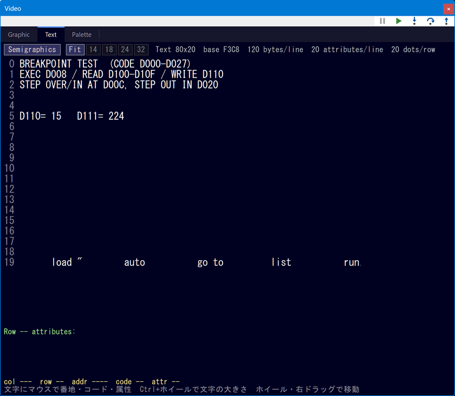

* **Graphic**：GVRAMの絵。B・R・Gの面ごとに出す・隠す、パレットの色と面の色の切り替え、拡大（Fit・x1・x2・x4・x8、Ctrl+ホイール）とスクロール（ホイール・Shift+ホイール・右ドラッグ）。マウスの下の座標・番地・各面の値・色番号を出し、クリックでメモリの窓のその番地へ移ります。
* **Text**（図）：テキストVRAMの文字と属性。マウスの下の文字の番地・コード・属性、その行の属性の並び、同じ属性が効いている範囲を出します。**Semigraphics**のボタンで、セミグラフィックの文字を点で描くか文字で出すかを切り替えます。文字の大きさは、Fit・14・18・24・32から選べます（Ctrl+ホイールでも）。
* **Palette**：8色と背景の色と、画面のモードに関わるポート30・31・32・53の値と意味。

窓の下に、マウスの下の情報を、位置をそろえていつも全部出します。

### Show Mnemonic Table

Z80の公式の命令の一覧（コード・ニーモニック・バイト数・サイクル数・フラグ・分類）。コード順・分類順に並べ替えられ、クリックで選んだ行は並べ替えても真ん中に出します。Help→**Legend...**で凡例を見られます。

### Show Sub System Log

メインCPUとディスク側のCPU（サブシステム）の通信（ポートFC・FD、選べばFE・FFも）を、時刻・クロック数・PC・説明付きで記録します。ファイルに保存できます。

### そのほか

Debugメニューには、M88のもとからある窓（OPNレジスタ・BASICのコード・Outport・FDCの状態など）もあります。

## 窓に共通の操作

* 表示スケールが100%以外の画面でもぼやけないように、DPIに対応しています（DPIの違うモニターへ移したときも合わせ直します）。
* マウスのホイールで動かせます。
* 文字の大きさを変えられます：Ctrl+ホイール、Ctrl+「+」「-」「0」（0は元の大きさ）、タイトルバーのメニューの「文字を大きく」「文字を小さく」「文字の大きさを元に戻す」。
* Ctrl+Cで中身をクリップボードにコピーできます。
* 右クリックのメニューやCtrl+G（Go to Address）でコード・メモリの窓のほかの番地へ移ると、移った先を次に移るまで色を変えて出します（コードの窓は行を青、メモリの窓はそのバイトを水色）。
* Debug→**Monitor Font...**で、フォントを選べます（等幅のフォントだけ。すべての窓で共通です）。既定はＭＳ ゴシックです。
* ToolsメニューのThemeでDarkを選ぶと、ペインのタブ・メニューの帯と、デバッグの窓のスクロールバーも暗くなります。

## 設定の保存

* Debug→**Save Settings per Disk/Tape**：ブレークポイント・ウォッチ・ラベルを、ドライブ1のディスクイメージかテープのファイルごとに「イメージの名前.m88dbg」へ保存し、そのイメージを入れたときに読み込みます。ディスクとテープの両方があるときは、最後に入れた（開いた）ほうを使います。読み込んだブレークポイントは、すべて無効の状態で入ります（ブレークポイントの窓で有効にします）。
* デバッグの窓の位置・大きさ・文字の大きさは、M88.iniの窓ごとのセクション（`[MonitorCode]`など）に保存します。ペインの並びは`[Dock]`に保存します（ペインの大きさ`Size0`〜`Size3`、開いているか`Shown0`〜`Shown3`、区画の大きさ`Groups0`〜・`Group0_0`〜、入れた窓`W0`〜）。
